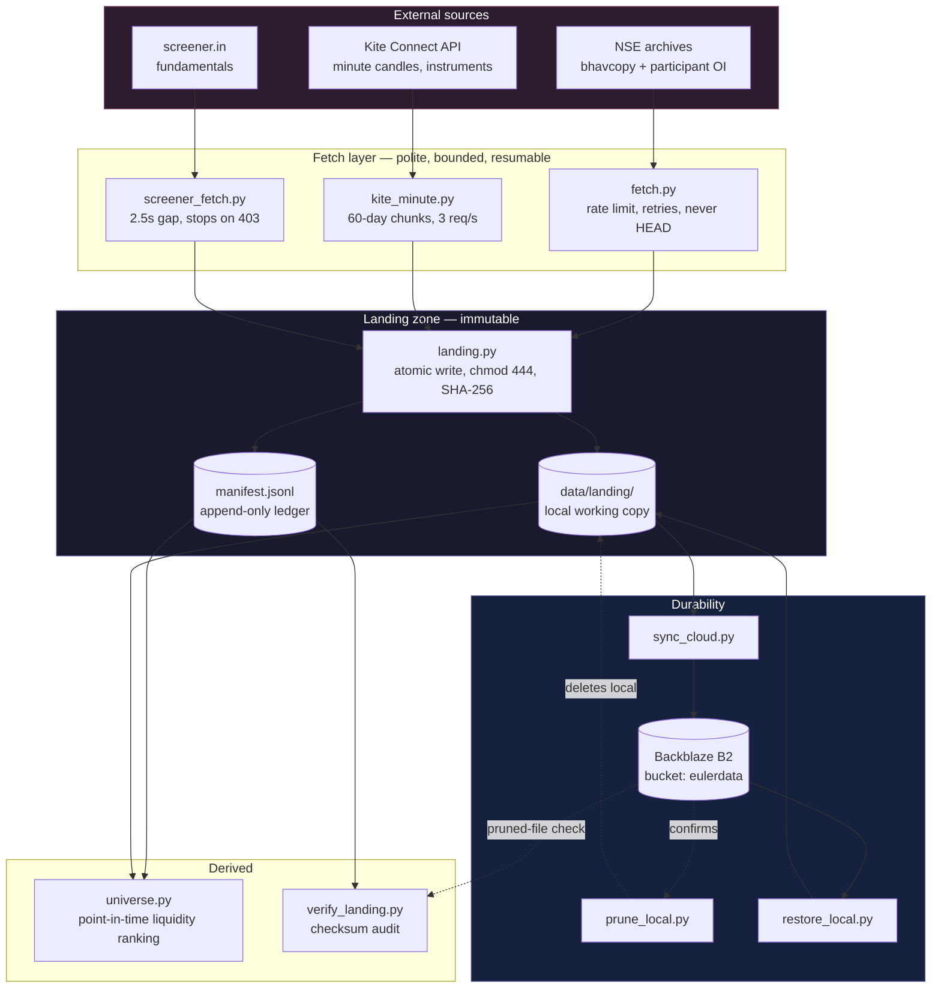
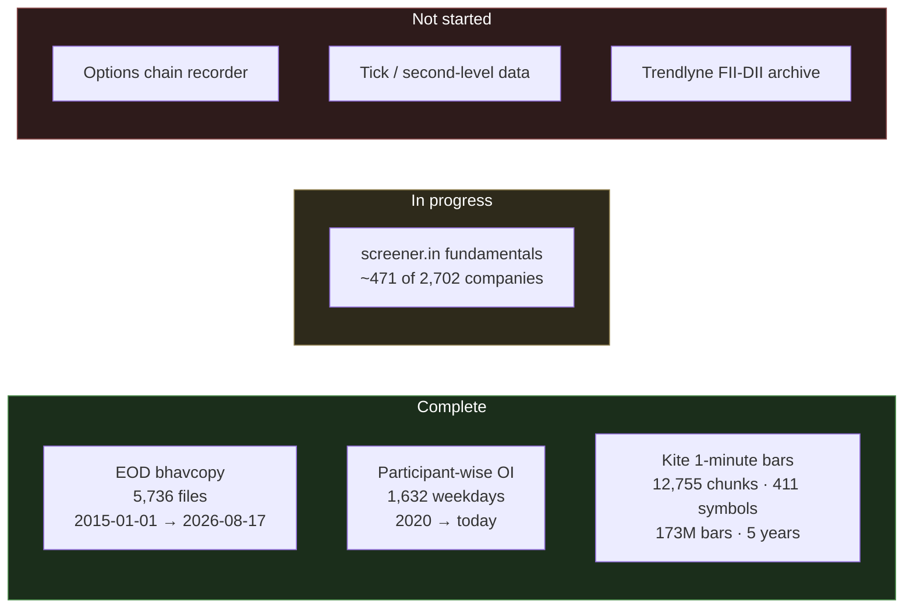
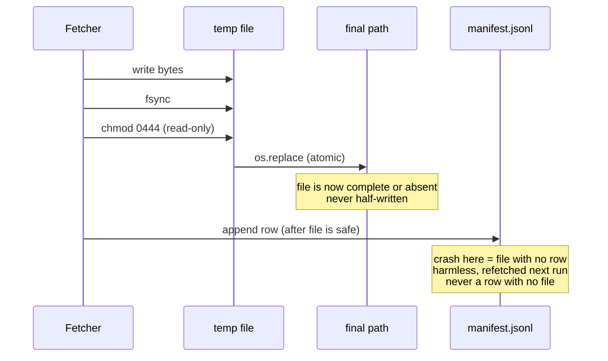
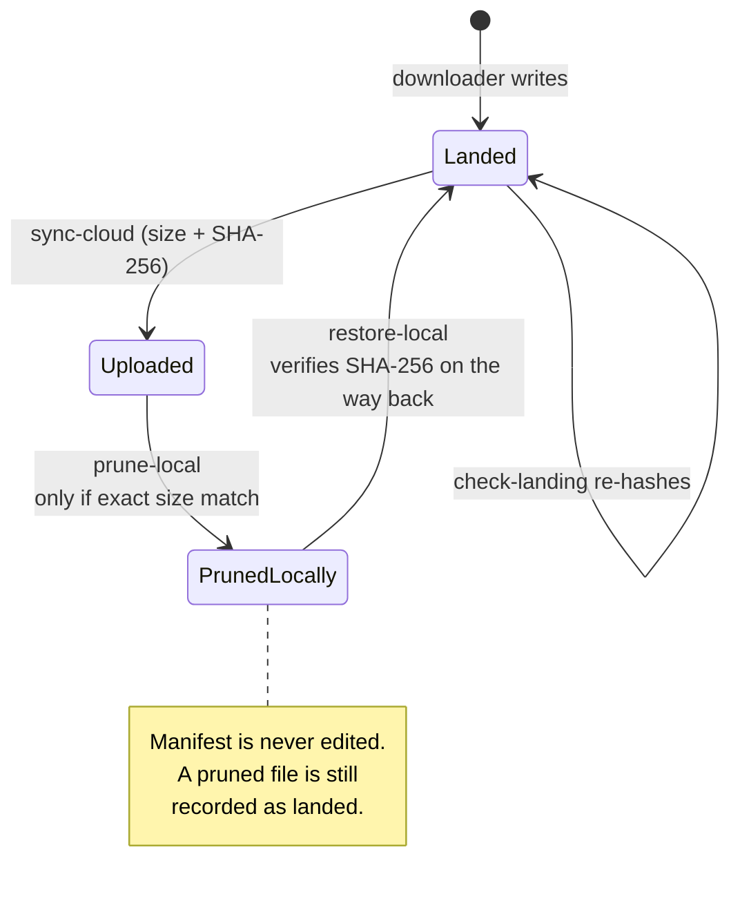
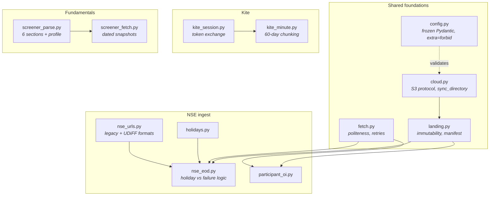
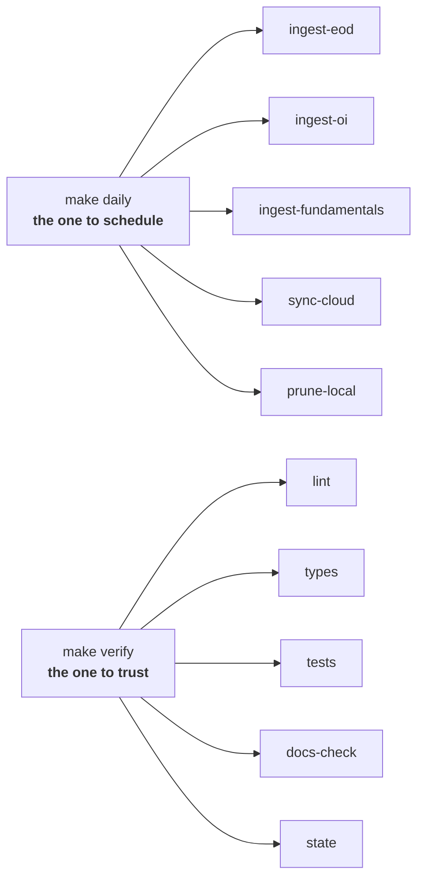

# Architecture — what exists, as of 2026-08-18

A picture of the system as built, not as planned. Everything here runs today;
nothing in this document is aspirational. For what is *not* built, see
`STATE.md` and `docs/AI_BUILD_PLAN.md`.

---

## The whole system

---

## Datasets

---

## The write path — why a crash cannot corrupt anything

This is the most important invariant in the system. It survived a `SIGKILL`
mid-run and an out-of-disk crash, in both cases leaving zero partial files.

The ordering is deliberate. A manifest row without a file would make a re-run
*skip* data it does not have — silent loss. The reverse is harmless.

---

## The prune / restore loop

Local disk is a working copy, not the archive. B2 is the archive.

**The trap this created:** `verify_landing` originally treated any locally
absent file as data loss, and `universe.py` silently ranked on whatever
remained on disk — producing a confident, wrong answer. Both now check B2 or
raise. See ADR-010.

---

## Module map

---

## Operator commands

Every ingest step is idempotent, so `make daily` is safe to run repeatedly and
a missed day self-heals on the next run. That property is what makes it
schedulable at all.

---

## Design rules the diagrams encode

1. **Raw bytes are never modified.** What lands is exactly what the source
   served — not re-compressed, not normalised. The landing zone is what makes a
   full rebuild possible when a parsing bug is found, and one will be.
2. **The manifest is the memory.** Idempotency and resumability come from an
   append-only ledger, never from in-process state, which is why any job
   resumes correctly after any kind of death.
3. **Failure and absence are different facts.** A 404 is `ABSENT`, a network
   error is `FAILED`. Conflating them is how data loss gets recorded as a
   holiday.
4. **Confirmed, not assumed.** Files are pruned only on an exact size match
   against the bucket, and restored only if the SHA-256 matches the manifest.
   "The sync command exited zero" is not evidence.
5. **Politeness is not optional.** Every fetcher is rate limited, retries are
   bounded, and a 403 stops the run rather than provoking harder retries.

---

## Known architectural gaps

| Gap | Consequence | Fixed by |
|---|---|---|
| No security master | Renamed and demerged tickers unresolved (ZOMATO→ETERNAL, TATAMOTORS→TMPV) | Sprint 3 |
| No bitemporal read API | Nothing yet prevents a backtest reading data it could not have had | Sprint 4 |
| Disk watchdog lives in the scratchpad | Dies with the session, not version controlled | should move into the repo |
| No DuckDB/query layer | Parquet files are queried ad hoc rather than through a curated store | ADR-003 defers this deliberately |
